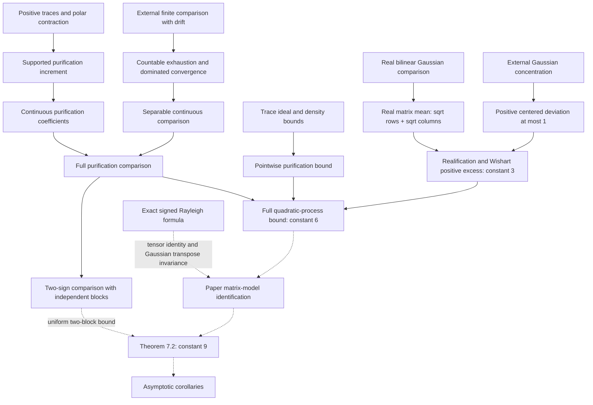

# Formalization report

This development contains proved finite-dimensional intermediate results. It
**does not prove Theorem 7.2** or either expected spectral-edge bound. The
constant **9** has not been replaced by an unspecified constant or claimed
under added assumptions. No free-edge formula is assumed. The final random Kronecker-matrix model
`H_M` and its spectral expectations are not yet assembled into public Lean
declarations.

## Mathematical objects and conventions

The namespace is `LehnerEdges`; all indices are finite.

| Paper object | Lean definition | Convention |
|---|---|---|
| Complex `N × N` matrix | `Mat N` | `Matrix (Fin N) (Fin N) ℂ` |
| Coefficients `A₁,…,Aₙ` | `A : Fin n → Mat N` | Merely reindexed from `1,…,n` to `0,…,n−1` |
| Density matrix | `Density N` | Subtype of PSD matrices with complex trace exactly `1` |
| `η(C)` | `covariance A C` | `∑ i, A i * C * A i` |
| `∑ Aᵢ²` | `squareFunction A` | Matrix squares, not entrywise squares |
| `Bᵢ(C)` | `compressed C (A i)` | `sqrt C * A i * sqrt C` |
| `E(C)`, equation (4) | `energy A C` | `sqrt C * covariance A C * sqrt C` |
| `St_{N,M}` | `Stiefel N M` | `W * Wᴴ = I_N`; rows are orthonormal |
| `‖T‖₁` | `traceNorm T` | `Re Tr sqrt(T Tᴴ)`, rectangular matrices permitted |
| `‖T‖_F²` | `frobeniusSq T` | `Re Tr(Tᴴ T)`; proved equal to sum of squared entry norms |
| Frobenius real pairing | `frobeniusPair S T` | `Re Tr(Sᴴ T)` |
| Operator norm | `‖T‖` | The scoped `Matrix.Norms.L2Operator` instance throughout |
| Largest/smallest eigenvalue | `lambdaMax B`, `lambdaMin B` | `sSup`/`sInf` of the **real spectrum**; spectral theorems require Hermitian `B` and `NeZero N` |
| Equations (2), (3) | `rhoPlus`, `rhoMinus` | Infimum over all positive definite `Z`; supremum over all `Z` with `-Z` positive definite |
| Definition after (3) | `rhoStar` | `max (rhoPlus A₀ A) (-rhoMinus A₀ A)` |
| Density functional `φ(C)` | `densityFunctional A₀ A C` | `Re Tr(A₀ C) + 2 Re Tr sqrt(E(C))` |
| Real Gaussian matrix coordinates | `matrixOfVector g` | `g` under Mathlib `stdGaussian` on complex Euclidean space, considered over `ℝ` |
| GUE | `gueProjection Z` | `(Z + Zᴴ)/2` applied to those real isotropic coordinates |
| Standard complex Gaussian | `complexGaussianMatrix g` | `matrixOfVector g / sqrt 2` |
| Wishart matrix | `wishartMatrix Γ` | `(Γ Γᴴ)/M` |

`CFC.sqrt` is the positive matrix square root. Its use is justified by proved
positivity at each mathematical step. `Z⁻¹` is Mathlib's nonsingular matrix
inverse; positive definite `Z` is invertible. Total definitions are available
in dimension zero, but no spectral-edge theorem uses the empty spectrum as if
it were nonempty. Real division by zero is total; the algebraic and
concentration lemmas that allow `M = 0` explicitly use this convention. This
extension is not a claim about the paper's random-matrix model at `M = 0`.

The underlying real inner product on complex Euclidean coordinates is proved
to be the real part of the complex inner product by
`euclidean_real_inner_eq_re`. This matters because Mathlib implements the real
Pi-space inner product and restriction of scalars through different instances.
For every Hermitian `K`, the explicit GUE construction satisfies

```
E Re Tr(G K) = 0,
Var(Re Tr(G K)) = ‖K‖_F².
```

These are `gue_mean_pair` and `gue_variance_pair`; `gue_pair_law` additionally
proves that each such test has exactly the centered real Gaussian law with
that variance. These results hold under an actual `stdGaussian`
law, with no caller-supplied distributional hypotheses. A separate theorem
stating the joint independence of the conventional upper-triangular GUE
coordinates has not been implemented.

## Correspondence table

Every declaration listed below is proved. Exact elaborated types, including
implicit dimensions, typeclasses, and all hypotheses, are in
[statements.txt](statements.txt), generated by [Statements.lean](Statements.lean).
The source files contain the full proof terms as tactic proofs.

| Paper result or proof step | Lean declarations | Scope and difference |
|---|---|---|
| Section 2: matrix norms and GUE normalization | `matrixVector_norm_sq`, `matrixVector_inner`, `gueProjection_pair`, `gue_mean_pair`, `gue_variance_pair`, `gue_pair_law` | Exact Frobenius/linear-pairing identities and scalar Gaussian laws; joint entry-law theorem not yet stated |
| Lemma 2.1: trace variational formula | `abs_frobeniusPair_le_traceNorm`, `polarContraction_pair`, `traceNorm_eq_sup_contractions` | **Contraction version only**: attained supremum over `‖W‖ ≤ 1`. The paper's coisometry equality, requiring `M ≥ N`, remains open |
| Theorem 2.3: Sudakov–Fernique with drift | `linear_gaussian_comparison`; external `sudakov_fernique_drift` | Finite comparison and the continuous separable-index extension `separable_linear_gaussian_comparison`, with Gaussian integrability proved from deterministic coefficient bounds |
| Lemma 3.2: weighted trace AM–GM | `trace_amgm`, `weighted_trace_amgm` | Exact **lower inequality** for every positive definite `Z`, including singular PSD `C,D`; infimum equality and approximation for equality remain open |
| Remark 3.6: elementary minimax direction | `densityFunctional_le_lehnerMatrix`, `densityFunctional_le_rhoPlus`, `rhoMinus_le_densityFunctional` | Exact elementary density inequalities for both variational edges; all coefficients may be Hermitian, positivity unnecessary |
| Propositions 3.3 and 3.5: full density duality | — | Equality and left-edge dual formula not proved |
| Lemma 4.1: two-fiber increment | `positive_cross_bound`, `two_fiber_stiefel_increment` | Exact constant `2`, PSD `P,Q`, arbitrary two coisometries |
| Lemma 4.2: density–Stiefel representation | — | Not proved |
| Proposition 4.3: increment calculation and comparison | `compressed_increment`, `coefficient_increment`, `finite_density_stiefel_comparison` | Finite restrictions and `full_purification_comparison` on the entire Frobenius unit sphere, exact scaling and common drift; identification with the Kronecker matrix spectral edge remains open |
| Section 5: trace ideal and singular-value estimates | `traceNorm_mul_le`, `traceNorm_mul_le_frobenius`, `polarContraction_factorization`, `opNorm_le_frobenius` | Rectangular estimates with no full-rank assumptions; proved directly using CFC and Frobenius Cauchy–Schwarz |
| Proposition 5.2: block algebra and `B_max` bound | `blockRow_mul_blockColumn`, `compressed_block_energy`, `compressed_block_traceNorm`, `density_energy_bound` | Exact block dimension `n*N`; exact bound `Tr sqrt E(C) ≤ sqrt ‖∑ Aᵢ²‖` |
| Proposition 5.2: uniform pointwise control | `pointwise_comparison_bound`, `finite_block_process_bound` | Deterministic part only, exact positive-part expression; no Wishart expectation hidden in assumptions |
| Lemma 5.1: Wishart identities and concentration | `wishartMatrix_posSemidef`, `wishart_sqrt_norm`, `complex_gaussian_matrix_norm_concentration` | Exact Gram norm identity, concentration, and `gaussian_wishart_positive_excess_le_three`: the positive-excess expectation with the paper’s constant 3. The sharp complex mean and the tail centered at `sqrt M + sqrt d` remain open |
| Proposition 5.3 / Proposition 6.1 | `gaussian_purification_edge_bound_six` | Constant 6 for the full quadratic process; expected matrix spectral-edge statements still await the matrix-model identification |
| Lemma 7.1: spectral Lipschitz control | `abs_lambdaMax_sub_le`, `abs_lambdaMin_sub_le`, `gueCoefficient_norm_le`, `finite_spectral_process_lipschitz` | Exact operator Lipschitz estimates and exact `σ/√M` coefficient bound for every finite spectral-process restriction. Full Kronecker model Lipschitz statement not proved |
| Section 7: Gaussian concentration | `stdGaussian_integrable_of_lipschitz`, `stdGaussian_hasSubgaussianMGF`, `stdGaussian_measure_ge_le`, `finite_spectral_process_concentration` | All globally Lipschitz functions on any finite real Hilbert space; finite spectral-process application has exact variance scale |
| Sections 3 and 6: variational sign symmetry | `rhoMinus_eq_neg_rhoPlus`, `rhoStar_eq_max_rhoPlus` | Exact identities `ρ₋(A₀,A) = -ρ₊(-A₀,A)` and `ρ* = max(ρ₊(A₀,A),ρ₊(-A₀,A))` |
| Alternative two-sign comparison | `full_signed_purification_comparison`, `signed_purification_increment` | Compares both signs simultaneously to independent rectangular Gaussian blocks, with actual Gaussian laws and drift |
| Alternative singular purification | `polarContraction_support`, `two_fiber_supported_increment`, `purification_increment` | Avoids coisometry extension; works with every rectangular purification, including singular ones |
| Real Gaussian mean bound | `real_matrix_process_eq_norm`, `real_gaussian_matrix_norm_mean_le` | Actual real matrix operator norm, mean at most `sqrt N + sqrt M` |
| Gaussian positive excess and realification | `stdGaussian_integral_positive_centered_le_one`, `complex_gaussian_matrix_norm_mean_le`, `complex_gaussian_normalized_excess_le` | Explicit exponential-moment proof and realification; complex mean bound is `sqrt (2N) + sqrt M`, sufficient for the exact constant-3 positive-excess estimate |
| Section 7: norm versus edges | `lambdaMax_neg`, `lambdaMin_neg`, `opNorm_eq_max_edges` | Exact spectral identities for Hermitian matrices in nonzero dimension; `opNorm_eq_signed_rayleigh_sup` also proves the signed unit-vector Rayleigh supremum formula |
| Theorem 7.2 | — | **Not proved**, including its constant 9 |
| Corollaries 1.2 and 1.3 / Section 8 / Section 9 | — | Asymptotic statements, covariance/Kraus invariance, and signed counterexamples not formalized |
| Theorem 1.1: free spectral-edge identification | — | Not formalized and not assumed as an axiom |

## Strongest assembled estimates

For arbitrary Hermitian coefficients in nonzero dimension, sign symmetry and
both elementary density inequalities are proved:

\[
 \varphi_{A_0}(C)\le\rho_+(A_0,A),\qquad
 \rho_-(A_0,A)\le\operatorname{Re}\operatorname{Tr}(A_0C)-2\operatorname{Re}\operatorname{Tr}\sqrt{E(C)},
 \qquad \rho_-(A_0,A)=-\rho_+(-A_0,A).
\]

These are not the density variational equalities of Propositions 3.3 and 3.5.

Let `σ = sqrt ‖∑ Aᵢ²‖`. For Hermitian `A₀,Aᵢ`, every density `C`, and arbitrary
rectangular matrices `Γᵢ`, `pointwise_comparison_bound` proves exactly

\[
 \operatorname{Re}\operatorname{Tr}(A_0C)
 +\frac{2}{\sqrt M}\left\|\sum_i B_i(C)\Gamma_i\right\|_1
 \le \rho_+ +2\left(\frac{\|\operatorname{stack}_i\Gamma_i\|_{op}}{\sqrt M}-1\right)_+\sigma.
\]

It requires `N > 0`, but does not require positivity of `Aᵢ`, a rank assumption,
or a probabilistic assumption about `Γ`. `finite_block_process_bound` also
controls the maximum of the corresponding pairings with any finite family of
coisometries. These are deterministic estimates, not expectation estimates.

For PSD `Aᵢ`, an arbitrary nonempty finite index type `ι`, density matrices
`C_t`, coisometries `W_t`, and arbitrary real drifts `a_t`,
`finite_density_stiefel_comparison` proves

\[
 \mathbb E\max_t(a_t+\langle v_t,g\rangle_{\mathbb R})
 \le \mathbb E\max_t(a_t+\langle w_t,h\rangle_{\mathbb R}),
\]

with standard Gaussian laws on the two real Hilbert spaces and

\[
 v_t=M^{-1/2}\operatorname{vec}_i(W_t^*B_i(C_t)W_t),\qquad
 w_t=\sqrt{2/M}\operatorname{vec}_i(B_i(C_t)W_t).
\]

The laws, zero means, and increment variances are constructed in the proof.
The `sqrt 2` in the second coefficient is the combination of the comparison
process's amplitude `2` and standard complex Gaussian normalization `1/sqrt 2`.
No compact supremum is silently identified with a finite maximum.

For Hermitian `Aᵢ`, that finite spectral process is Lipschitz with constant
`σ/√M`. Its right-tail probability at distance `t ≥ 0` above its actual mean is
at most

\[
 \exp\!\left(-\frac{t^2}{2(\sigma/\sqrt M)^2}\right).
\]

For `M > 0` this is the paper's `exp(-M*t²/(2*‖∑ Aᵢ²‖))`. When the variance
parameter vanishes, the displayed total-division bound is still valid but
trivial; no special zero-variance tail claim is inferred from it.

The direct comparison uses unit Frobenius purifications `S`, with `C = S S*`,
and proves directly

\[
 v_S=M^{-1/2}\operatorname{vec}_i(S^*A_iS),\qquad
 w_S=\sqrt{2/M}\operatorname{vec}_i(\sqrt{SS^*}A_iS),\qquad
 \|v_S-v_T\|^2\le\|w_S-w_T\|^2.
\]

These coefficients are continuous even at rank-deficient matrices. Their
bounds prove integrability of the full supremum. For positive dimensions,
PSD `A_i`, and Hermitian `A_0`, `gaussian_purification_edge_bound_six` proves

\[
 \mathbb E\sup_{\|S\|_F=1}
 [\operatorname{Re}\operatorname{Tr}(A_0SS^*)+\langle v_S,g\rangle]
 \le\rho_+ +6\sqrt{nN/M}\,\sigma.
\]

This is an actual continuous supremum and expectation, with no assumed
moment or measurability hypotheses. Its matrix-model interpretation remains
a separate unproved connection. The Gaussian estimates also prove exactly

\[
 \mathbb E\left(\sqrt{\|\Gamma\Gamma^*/M\|}-1\right)_+
 \le 3\sqrt{d/M},
\]

for a standard complex `d × M` Gaussian matrix. The proof first bounds its
norm by a real `2d × M` Gaussian norm, retaining the leading column term one,
then uses exponential moments to bound the positive centered deviation by one.

## Dependency overview

Solid arrows denote proved dependencies. Dotted arrows mark unfinished steps.
This is a route toward Theorem 7.2, **not** a claim that it has been obtained.



## Remaining obstacles, precisely

1. **Matrix-model identification.** The signed unit-vector Rayleigh formula
   for an actual Hermitian matrix is proved. The remaining step is the
   entrywise Kronecker/vectorization identity relating the paper's `H_M` to
   the proved quadratic coefficients. Vectorizing an `N × M` purification
   introduces a transpose on the GUE factor; Gaussian invariance under this
   coordinate permutation must be proved and used explicitly. No random
   Kronecker model is currently substituted by definition for its supremum.
2. **Assembling the two-sign upper bound.** The full two-sign comparison is
   proved under actual Gaussian measures. The one-sign trace-process identity,
   uniform pointwise estimate, block Gaussian isometry, and expectation bound
   are also proved. The remaining uniform estimate must control both
   independent rectangular blocks by one stacked Gaussian matrix. This needs
   an operator-norm bound for restricting rows and a matching coordinate
   isometry. Combining these with the matrix-model identity and explicit
   numerical simplification is still required for Theorem 7.2. A sufficient
   route uses `2nN` complex rows: the proved constant-3 Wishart estimate
   would give an error `6 sqrt(2nN/M) sigma`, and `6 sqrt 2 ≤ 9` gives
   the requested constant. The uniform two-block step is not yet proved.
3. **Sharper subsidiary Gaussian statements.** The exact constant-3
   positive-excess conclusion of Lemma 5.1 is proved by an alternative route.
   The sharp complex mean `E||Γ|| ≤ sqrt M + sqrt d` and the lemma's displayed
   tail around that threshold remain unformalized. They are unnecessary for
   the integrated constant-6 quadratic-process bound already proved.
4. **Density dual equalities.** These are unnecessary for Remark 3.6's upper
   bound route. Lemma 3.2's infimum equality needs singular-matrix
   approximation; Propositions 3.3/3.5 additionally need a minimax equality
   or a direct dual argument. Only the sufficient elementary inequalities
   have been formalized.
5. **Free spectral identification.** No free semicircular family, Fock-space
   construction, or Lehner formula is assumed or constructed. The finite
   variational quantities remain separate from free spectral edges.
6. **Remaining consequences.** The asymptotic corollaries need the actual
   finite matrix expectation theorem. The lower-edge statement also requires
   symmetry in law of the GUE family. Section 8 needs Gaussian invariance
   under real orthogonal mixing and a Kraus-decomposition argument; Section 9
   needs the explicit signed counterexamples.
